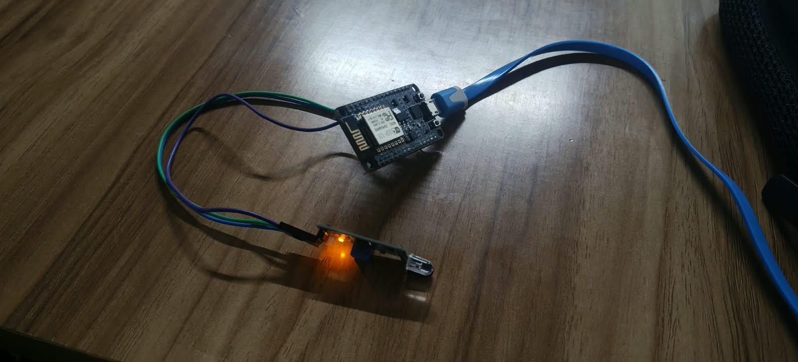
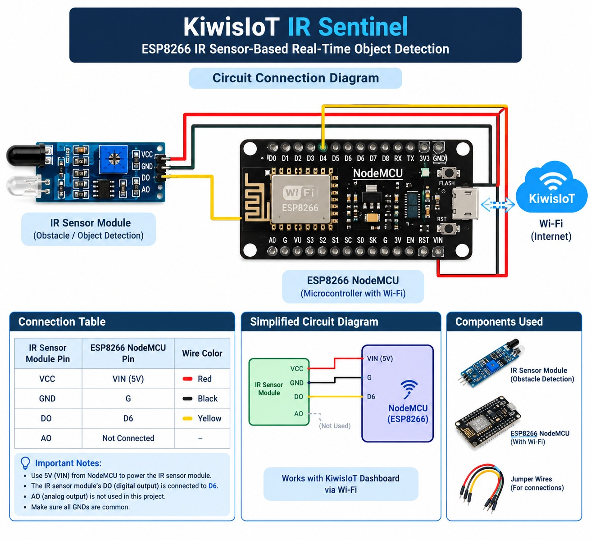
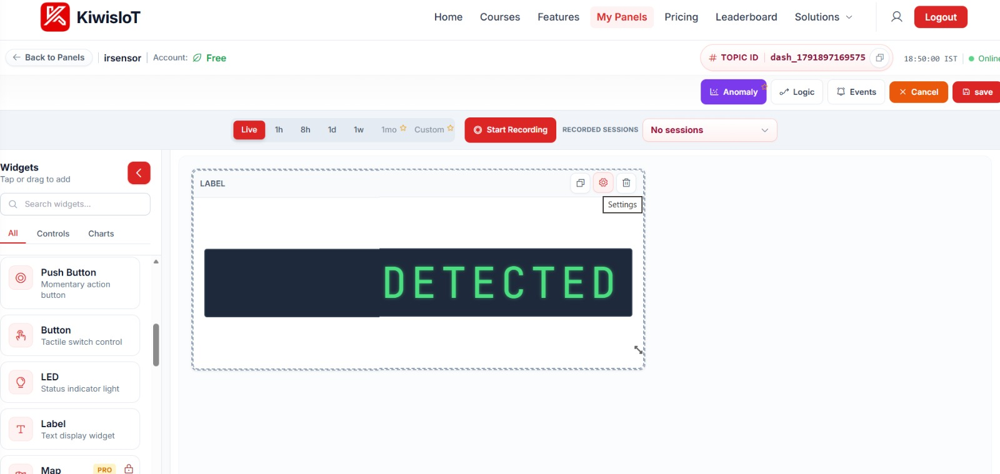

# 🛰️ IR Sentinel – KiwisIoT: ESP8266-Based Real-Time Object Detection


**IR Sentinel KiwisIoT** is a simple IoT-based object detection and remote monitoring project built with an **ESP8266 NodeMCU** and an **infrared (IR) obstacle detection sensor**. The ESP8266 reads the sensor's digital output and sends the detection status (**DETECTED** / **NOT DETECTED**) to a **KiwisIoT** dashboard over Wi-Fi.

<p align="center">
  
</p>

---

## 📑 Table of Contents

- [Project Objective](#-project-objective)
- [How It Works](#-how-it-works)
- [System Architecture](#-system-architecture)
- [Hardware Components](#-hardware-components)
- [Software Requirements](#-software-requirements)
- [Circuit Connection](#-circuit-connection)
- [KiwisIoT Dashboard](#-kiwisiot-dashboard)
- [Arduino Code](#-arduino-code)
- [Getting Started](#-getting-started)
- [Real-Time Monitoring](#-real-time-monitoring)
- [Applications](#-applications)
- [Limitations](#-limitations)
- [Security](#-security)
- [Repository Structure](#-repository-structure)
- [Conclusion](#-conclusion)

---

## 🎯 Project Objective

Build an affordable object detection system that can:

- Detect objects using an IR sensor
- Read the sensor's digital output using an ESP8266
- Identify the status as **DETECTED** or **NOT DETECTED**
- Transmit the status to KiwisIoT over Wi-Fi
- Display the latest received status on an IoT dashboard

---

## ⚙️ How It Works

The IR sensor emits infrared light and detects the light reflected from an object within its operating range. Its digital output changes according to the module's detection threshold and configuration.

The ESP8266 reads this digital output and converts it into a text status. The KiwisIoT library sends the status to the configured dashboard channel, so the latest reading can be viewed remotely.

---

## 🏗️ System Architecture

```
IR Sensor  →  ESP8266 NodeMCU  →  Wi-Fi  →  KiwisIoT Dashboard
```

The IR sensor supplies the detection signal, the ESP8266 processes it, and the KiwisIoT dashboard presents the transmitted status.

---

## 🧰 Hardware Components

- ESP8266 NodeMCU development board
- IR obstacle detection sensor module with digital output
- Jumper wires
- USB cable (programming and power)
- Computer with Arduino IDE
- Wi-Fi connection
- KiwisIoT account and dashboard

## 💻 Software Requirements

- Arduino IDE
- ESP8266 Arduino Core
- `ESP8266WiFi` library
- `KiwisIoT` library
- KiwisIoT dashboard with a configured topic and data channel

---

## 🔌 Circuit Connection

<p align="center">
  
</p>

| IR Sensor Pin | ESP8266 NodeMCU Pin | Wire Colour |
|---------------|---------------------|-------------|
| `VCC` | `VIN (5V)` | 🔴 Red |
| `GND` | `G` | ⚫ Black |
| `DO` | `D6` | 🟡 Yellow |
| `AO` | Not connected | – |

**Notes**
- Use 5V (`VIN`) from the NodeMCU to power the IR sensor module.
- The module's `DO` (digital output) goes to `D6`.
- `AO` (analog output) is not used in this project.
- Make sure all grounds are common.

---

## 📊 KiwisIoT Dashboard

<p align="center">
  
</p>

1. Log in to KiwisIoT and create a new panel (for example, *irsensor*).
2. Add a **Label** (text display) widget and bind it to the data channel used in the code.
3. Copy the panel's **Topic ID** into the Arduino sketch.
4. Save the panel to see the live status.

---

## 👨‍💻 Arduino Code

The sketch is in [`IR_Sentinel/IR_Sentinel.ino`](IR_Sentinel/IR_Sentinel.ino).

- Reads the IR module on `D6`
- Most IR obstacle modules pull `DO` **LOW** when an object is detected; flip the logic if yours differs
- Sends `DETECTED` or `NOT DETECTED` to KiwisIoT every second

---

## 🚀 Getting Started

1. Clone the repository
   ```bash
   git clone https://github.com/<your-username>/IR-Sentinel-KiwisIoT-Object-Detection.git
   ```
2. Install the Arduino IDE, ESP8266 board package and KiwisIoT library.
3. Wire the sensor as shown in [Circuit Connection](#-circuit-connection).
4. Open `IR_Sentinel/IR_Sentinel.ino` and set your Wi-Fi name, password and topic ID.
5. Select **NodeMCU 1.0 (ESP-12E Module)** and the correct port, then upload.
6. Open the Serial Monitor at **115200 baud** and watch the KiwisIoT dashboard.
7. Place and remove an object in front of the sensor to see the status change.

---

## 📡 Real-Time Monitoring

The program checks the sensor periodically and sends its current status to KiwisIoT. The dashboard shows the received text, such as **DETECTED** or **NOT DETECTED**. Update speed depends on the sending interval, Wi-Fi connectivity and dashboard configuration.

---

## 🧪 Applications

- Basic object presence monitoring
- Educational IoT demonstrations
- Simple proximity detection experiments
- Entry or passage monitoring prototypes
- Learning sensor interfacing and wireless data transmission

## ⚠️ Limitations

Detection range and reliability depend on the sensor module, object surface, ambient lighting and sensor adjustment (potentiometer). This project is an educational demonstration, **not** a safety-certified detection system.

---

## 🔒 Security

- Never commit real Wi-Fi credentials or your KiwisIoT topic ID. Keep the placeholders in the repository.
- Store secrets in a separate `secrets.h` file and add it to `.gitignore`.
- If a topic ID has appeared in a public screenshot, regenerate or replace it.

---

## 📁 Repository Structure

```
IR-Sentinel-KiwisIoT-Object-Detection/
├── IR_Sentinel/
│   └── IR_Sentinel.ino
├── images/
│   ├── circuit_diagram.jpeg
│   ├── kiwisIoT_output.jpeg
│   └── live_test_result.jpeg
└── README.md
```

---

## ✅ Conclusion

IR Sentinel KiwisIoT combines infrared sensing, ESP8266 programming, Wi-Fi communication and cloud-based dashboard monitoring in one beginner-friendly project. It is a foundation for more advanced IoT monitoring systems using additional sensors and notification features.
